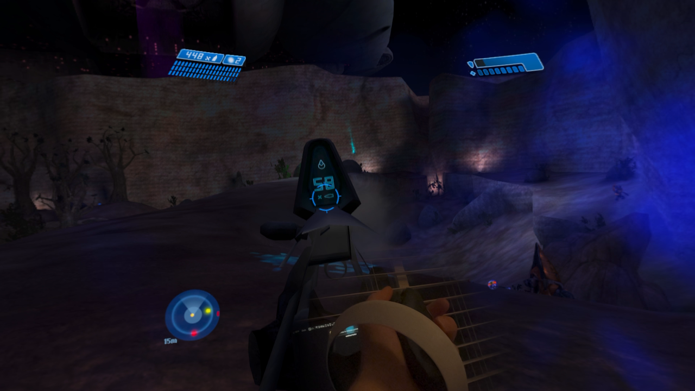
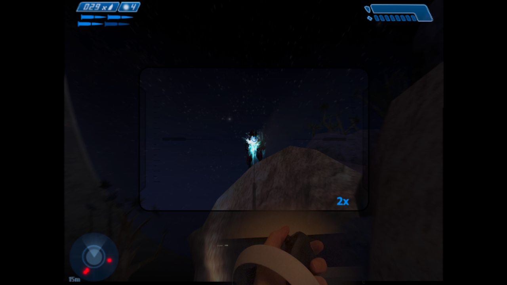
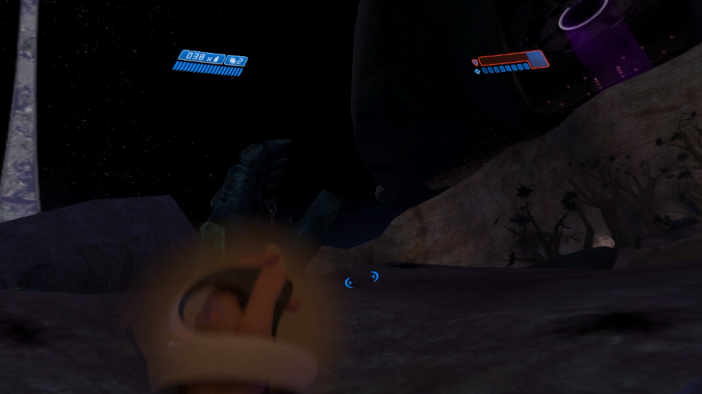

**[Windows / Linux: download the IPA and follow the full installation guide](docs/SIDELOADING.md)**

**Downloads:** [Choose iPhone/iPad, Vision Pro or Mac](docs/DOWNLOADS.md).

# 117

**Halo: Combat Evolved on Vision Pro, iPad and iPhone. Immersive on the headset. Full-screen on mobile. Shared saves and settings through iCloud.**

117 is an unofficial native Apple port built on [Master Chef](https://github.com/mitchaiet/master-chef), with PSVR2 Sense tracked aiming, two-handed weapon support, physical interactions and optional dual wielding. The game runs on your device; you do not need a PC streaming it in the background.

[**Windows / Linux IPA guide →**](docs/SIDELOADING.md) · [Mac source build](docs/INSTALL.md) · [Controls](docs/CONTROLS.md) · [Mobile controls](native/EnginePad/INPUT.md) · [Known issues](docs/KNOWN_ISSUES.md)



*Actual Vision Pro gameplay recorded by the project author. These stills show an earlier development build, not a mockup or a validation of the latest build.*

## One campaign, across your devices

| Platform | How you play |
| --- | --- |
| **Vision Pro** | Start in a window, then Expand into immersive play. Closing immersive returns to the same running game. Use PSVR2 Sense for tracked aiming and physical interactions, or a regular gamepad. |
| **iPad** | Full-screen Metal rendering that adapts to the window's aspect at launch. Play with a controller, Magic Keyboard and mouse/trackpad, or on-screen controls. |
| **iPhone** | The same mobile app in landscape, with controller, keyboard/mouse or automatic touch controls. |

Only **Halo: Combat Evolved** is supported. Halo 2, 3, Reach and 4 are not implemented.

## Built for playing with your hands

- **Aim the weapon with your Sense controller.** Bring the other hand to a rifle's foregrip for two-handed support; the sniper scope follows weapon aim.
- **Throw grenades from your hand.** Hold L1, make a throwing motion, then release. A visible grenade preview shows that it is armed.
- **Use gestures or buttons.** Swing to melee, reach toward your shoulder to swap weapons, or keep using the familiar button controls. Reload and melee retain Halo's animations.
- **Try optional dual wielding.** Carry an assault rifle and pistol together, with independent aiming and firing.
- **Turn the way you prefer.** Point-to-turn, smooth stick, snap turns and physical turning are available, with recentering and presentation settings.
- **Adjust the picture.** Native-resolution/display-refresh options, texture and shader packs, and graphics settings are available. Actual performance depends on the device and scene.

| Weapon-tracked sniper scope | Motion-controlled grenade throw |
| --- | --- |
|  |  |

Sense tracking currently targets **on-foot campaign play**. Vehicles and turrets use conventional stick controls; turn tracked aiming off for multiplayer. See [controls and current limits](docs/CONTROLS.md).

## Keep your progress

117 includes local saves, optional **iCloud save sync**, recovery snapshots and explicit conflict handling. Supported app settings sync too. Mobile quality preferences are shared by iPad and iPhone; headset calibration stays local. Halo profiles and saved control bindings travel with the game saves.

The public **130.1 sideload preview uses local saves** and does not include the
maintainer's iCloud configuration. The cloud setup below applies to source
builds configured with your own developer team.

After playing, **fully close and reopen 117**, then let Cloud Saves finish in the launcher before switching devices. It is not live checkpoint streaming. Both apps need the same iCloud account and a shared container configured under your developer team. See [cloud setup and switching devices](docs/INSTALL.md#7-carry-your-progress-between-devices).

## Install from zero

**Vision Pro from Windows or Linux:** the experimental
[Build 130.1 IPA and full walkthrough](docs/SIDELOADING.md) cover Apparition,
pairing, Apple signing, installation, Halo-data import and refreshes. You do
not need a Mac to install that published IPA. Bring your own **retail Halo PC
1.10 installation and registration**; no retail game files are supplied.
Fresh-recipient installation and gameplay through this route remain unverified.

**Building from source on a Mac:** the steps below need an Apple Silicon Mac,
Xcode, an enrolled Apple Developer Program team, and the same owned game inputs.
Vision Pro requires visionOS 26+; the mobile target requires iOS/iPadOS 18+.

1. [Prepare the Mac and download this repository](docs/INSTALL.md#1-get-the-prerequisites).
2. [Import your retail PC disc/ISO or existing Windows installation](docs/INSTALL.md#3-prepare-your-game-files).
3. [Configure your signing and shared iCloud container](docs/INSTALL.md#4-configure-your-signing-and-shared-icloud-container).
4. [Build and install through Xcode on each device](docs/INSTALL.md#5-build-and-install-on-your-device).
5. [Open 117, select the **1** game card, and play](docs/INSTALL.md#6-start-playing).

The [complete installation guide](docs/INSTALL.md) walks through every step and includes the commands. An ISO is installation media, not a file the app opens. Xbox, Mac-edition, Custom Edition, Anniversary and MCC files are not interchangeable with the supported Windows executable.

For advanced setup, see the [guided installer](docs/SETUP.md), [manual build/signing guide](docs/BUILDING.md), [mobile build guide](native/EnginePad/README.md), or [agent setup guide](docs/AGENT_SETUP.md).

## Project status

117 is in active development. Vision Pro gameplay has been tested by the author. The latest mobile gameplay and live cross-device cloud roundtrip still need physical acceptance; passing source checks and signing a build do not establish those results. See [validation](docs/VALIDATION.md), [known issues](docs/KNOWN_ISSUES.md) and the [changelog](CHANGELOG.md).

To run portable source checks:

```sh
python3 tools/run_source_checks.py --portable-only
```

Full native, Metal and Swift checks require an Apple Silicon Mac and the relevant SDKs. Original-engine fixtures also require locally generated code. See [contributing](CONTRIBUTING.md).

## Foundation and credits

117 is an independent continuation of **[mitchaiet/master-chef](https://github.com/mitchaiet/master-chef)**. Its executable translation, native runtime, Metal renderer and original visionOS presentation are the foundation for this work.

The original MIT [license](LICENSE) and copyright notice are retained. See [THIRD_PARTY.md](THIRD_PARTY.md) and [asset notices](docs/ASSET_NOTICES.md). Gameplay screenshots contain original game imagery; that content is separate from the MIT-licensed code and the project's original app artwork.

Halo and its game content belong to their respective owners. 117 is not affiliated with or endorsed by Microsoft, Halo Studios, Bungie, Gearbox, Sony or Apple. The source checkout does not include retail game files, registration, saves, translated executable output or signed apps. The separate IPA release contains the compiled runtime and must be re-signed for the recipient. Historical upstream archives are separate artifacts.

## Issues

Found a reproducible bug or have a concrete feature request? [Check existing issues](https://github.com/zschwendi/117-vision/issues) first, then open an issue if needed. For bugs, include your device/OS, app version, steps to reproduce, expected and actual behavior, and relevant logs. For features, explain the use case. Please keep Issues focused on bugs and feature requests.
